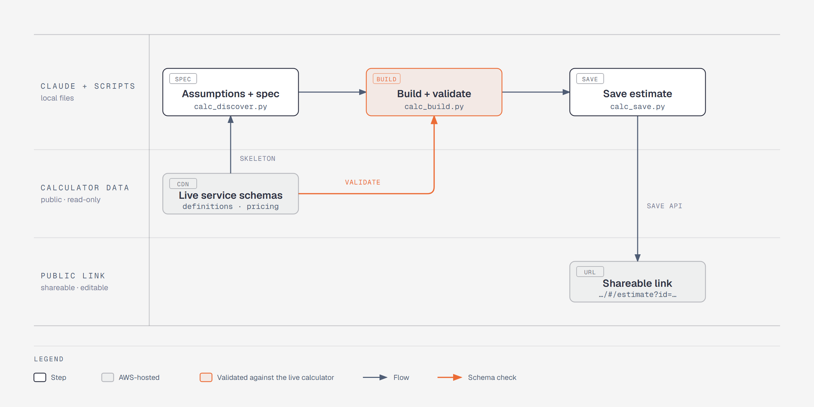

# AWS Pricing Calculator Skill

Generate shareable [AWS Pricing Calculator](https://calculator.aws) URLs from architecture descriptions, blog posts, or solution documents. Use them for MAP (Migration Acceleration Program) funding applications, customer proposals, and internal cost reviews.

**How is this different from the AWS Pricing MCP?** The AWS Pricing MCP looks up unit prices (e.g. "$0.0416/hr for t3.medium"). This skill goes end-to-end. It discovers the calculator's live input schemas, builds and **validates** the estimate JSON, and saves it to the calculator. The result is a URL stakeholders can open and edit.

## How it works



Diagram source: [`docs/workflow.html`](docs/workflow.html).

## Install

```bash
npx skills add quincysting/claudeskill_awspricing_calculator
```

Or clone into `~/.claude/skills/aws-pricing-calculator/`.

## Prerequisites

| Prerequisite | Required for | Notes |
|---|---|---|
| Python 3.10+ | scripts | stdlib only, no `pip install` |
| curl | scripts | all HTTP goes through curl |
| [AWS Pricing MCP Server](https://github.com/awslabs/mcp/tree/main/src/aws-pricing-mcp-server) | optional | unit prices for the expected-cost cross-check |

## What it does

1. **Extracts services** and usage assumptions from the source document
2. **Discovers schemas** from the live calculator definitions: input ids, valid option and unit ids, defaults, and when each input is visible
3. **Builds the estimate**, filling `version` / `estimateFor` from the live definition, with support for group services such as S3 and DynamoDB
4. **Validates** every input the way the calculator loads it: unknown ids, invalid enum values, wrong units, missing inputs that would load as 0, table rows checked against the calculator's pricing data, inactive services, regions
5. **Saves** the estimate and confirms the stored copy matches what was sent

## Why validation matters

When a saved estimate is opened, the calculator **recomputes** every service from `calculationComponents`. Small format mistakes change the result without any error:

| Mistake | What the calculator did (observed) |
|---|---|
| EC2 `pricingStrategy: "onDemand"` (should be `"on-demand"`) | service turned **Read-only** |
| fileSize `"unit": "gb"` (should be `"gb\|NA"`) | storage value dropped ("30 undefined") |
| Secrets Manager duration `730` with no unit | read as 730 days: **$19.52 instead of $0.86** |
| dropdown value not an option id | silently falls back to the default option |
| optional input left out | loads as **0**, not as the UI default |
| MSK broker `"kafka.m5.large"` (should be `"m5.large"`) | row rejected, MSK priced at **$0.00** ("Required input") |
| RDS Oracle edition `"Standard Edition Two"` (should be `"Standard Two"`) | "Invalid Selection", another edition priced |
| OpenSearch master / UltraWarm tables left out | default rows priced: 3 masters + 2 UltraWarm nodes |

`calc_build.py` and `calc_save.py` refuse to write or upload estimates with these errors.

## Service formats

`references/service_formats.md` holds ready spec blocks, all priced in the calculator (2026-11-08): EC2 (with On-Demand, Savings Plans, Reserved and Spot strategies), EBS, S3 (group), Secrets Manager, Managed Apache Flink, AppStream, RDS for Oracle, MSK Provisioned, OpenSearch.

Any other active service (430+) works through `calc_discover.py --skeleton` (table inputs filled from the calculator's pricing data).

## Usage

Invoke via `/aws-pricing-calculator` or phrases like:

- "Create an AWS cost estimate for this architecture"
- "Generate a pricing calculator URL for this blog post"
- "Cost this architecture on AWS"

## Standalone CLI

```bash
cd scripts
python calc_discover.py --list database                          # find service codes
python calc_discover.py amazonElasticBlockStore                  # inputs, ids, units
python calc_discover.py amazonElasticBlockStore --skeleton spec.json
python calc_build.py spec.json -o estimate.json                  # build + validate
python calc_save.py estimate.json                                # save + round-trip check
python calc_fetch.py "https://calculator.aws/#/estimate?id=..." --spec spec.json   # edit an existing one
```

## Tests

```bash
python tests/test_calc.py        # offline unit tests (or: pytest tests/)
python tests/check_formats.py    # re-validate documented formats against the live calculator
```

## License

MIT
